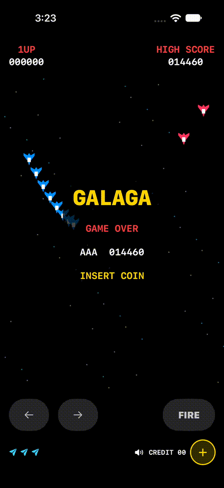

# Retro Shooter — SwiftUI arcade game

Retro Shooter is a single-player iOS space shooter inspired by classic Galaga arcade gameplay. Pilot a fighter, dodge enemy fire, clear increasingly difficult formations, and rescue captured ships to build a dual fighter. The project also serves as a beginner-friendly example of building a 2D game in Swift and SwiftUI without storyboards.

The app uses original geometric ships and synthesized audio. It is an independent fan project, not an official Galaga release or an arcade ROM emulator.

## Gameplay preview

## Key features

- Arcade attract screen, free coin credits, and a start screen.
- Horizontal drag controls, movement buttons, and tap-to-fire shooting.
- Forty enemies per normal stage, animated entrances, breathing formations, and diving attacks.
- Two-hit bosses, weaker escorts and grunts, and straight-down enemy bullets.
- Automatic stage progression with increasing difficulty and challenge rounds at stages 3, 7, 11, and beyond.
- Tractor-beam capture, captured-ship rescue, and dual-fighter firepower.
- Three reserve ships, score-based extra lives, and brief protection after respawning or rescuing a fighter.
- Persistent local high score with initials registration.
- Scrolling starfield, animated ships, synthesized sound effects, and a mute button.
- SwiftUI TimelineView and Canvas rendering with a fixed 60 Hz game simulation.

## Requirements

- A Mac with Xcode 16 or newer to open the included project format.
- An iPhone or iPad running iOS/iPadOS 17 or newer, or an installed iOS simulator.
- No third-party packages, storyboard, or external image/audio downloads are required.

## Build and run

1. Open `RetroShooter.xcodeproj`.
2. Select the RetroShooter scheme and an installed iPhone simulator.
3. Press Command-R. Install a simulator runtime in Xcode Settings → Components if needed.
4. For a physical phone, select your team under Signing & Capabilities and use a unique bundle identifier.

## How to play

1. Launch the app to see the GAME OVER attract screen.
2. Tap the circular **+ coin button** to add a free credit. No payment is required.
3. Tap **START** on the PUSH START BUTTON screen. One credit starts a game with one active fighter and three reserve ships.
4. Drag your finger horizontally across the playfield, or tap the left/right arrow buttons, to move.
5. Tap the playfield or **FIRE** to shoot. Dodge descending shots and diving enemies while clearing each formation.
6. Destroy the boss carrying your captured fighter to gain two fighters and parallel shots.
7. Complete stages to advance automatically. Aim for all 40 hits in challenge rounds for a perfect bonus.
8. When all ships are lost, enter your initials if you set a new high score. Add another free credit, or use a remaining credit, to start again.

Tap the **speaker button** to mute or enable sound. Unused credits carry over between stages and games during the current app session. High scores and registered initials are saved locally between launches. The simulation pauses when the app is inactive.

## Stage and combat rules

- Normal stages introduce 40 enemies in five groups of eight along cubic Bezier paths. The grid breathes while assembling.
- Top-row green bosses take two hits and turn blue after the first. Pink middle-row escorts and yellow bottom-row grunts take one hit. Bosses award 400 points, escorts 160, grunts 100.
- Stage 1 has no entrance fire. Diving enemies fire missiles straight down from their firing position. Shots keep the same X coordinate, so moving aside dodges them. From stage 2, enemies also shoot during entrance. Stage 2 allows one shot per entrance group, a shared 0.9-second firing cooldown, and at most three enemy bullets on screen. Higher stages gradually increase those limits. Difficulty increases with stage: faster entrances, faster shots, shorter dive intervals, and boss escorts.
- Enemies dive toward a snapshot of the fighter's position, fly offscreen, then return from above. A leader is randomly selected; bosses may bring up to two escorts.
- Clearing a stage shows a short result screen and automatically advances without spending another credit or resetting score or lives.
- Stage 3 is the first challenge round, followed by stages 7, 11, and so on. Forty enemies fly across without firing or damaging the fighter. Escaped enemies leave the round. Results show hits and a bonus of 100 per hit, or 10,000 for all 40, in addition to normal kill points.
- Single fighters can have two missiles on screen. Dual fighters can have four. Extra ships are awarded at 20,000, 70,000, then each further 70,000 points.

## Capture and rescue

An eligible diving boss pauses midway and opens a pulsing tractor beam. The beam visibly extends downward first. Capture requires the unprotected fighter’s center to remain inside the visible beam for 0.25 seconds; wing-only contact does not capture, and moving out cancels the pull. The fighter then spins upward through the still-visible beam, and a reserve ship is used for the replacement. Destroy its carrier while diving, returning, or in formation to rescue it and form a dual fighter. The rescued pair receives three seconds of protection so its wider hitbox cannot immediately lose the upgrade. The dual fighter has two parallel shots, a wider hitbox, and loses one fighter when hit. A respawn grants three seconds of blinking protection. Capturing the last remaining fighter ends the game.

## How the code works

- `RetroShooterApp.swift`: SwiftUI app entry point.
- `GameView.swift`: TimelineView, Canvas rendering, arcade screens, touch controls, and simple two-frame enemy animation.
- `GameViewModel.swift`: state transitions, fixed 60 Hz simulation accumulator, movement, hitboxes, combat, stages, and scoring. Catch-up is capped after long frame stalls; inactive scenes reset the clock.
- `ArcadeAudio.swift`: original synthesized square-wave and noise sound cues for firing, diving, damage, capture, rescue, and stage starts. No arcade recordings are included.
- `Checks/ArcadeChecks.swift`: standalone model checks outside the app target. Compile alongside GameViewModel.swift with swiftc to check credits, missile limits, boss health, entrance fire, progression, challenge results, and extra lives.

This is a playable interpretation with original visuals and audio, rather than a timing-accurate emulation of the arcade ROM. Capture/rescue balance, sound levels, and touch feel should also be checked during simulator/device play.

## License

This project is licensed under the [Apache License, Version 2.0](LICENSE).

Copyright 2026 Ena Tarumi

Licensed under the Apache License, Version 2.0 (the "License");
you may not use this file except in compliance with the License.
You may obtain a copy of the License at

    http://www.apache.org/licenses/LICENSE-2.0

Unless required by applicable law or agreed to in writing, software
distributed under the License is distributed on an "AS IS" BASIS,
WITHOUT WARRANTIES OR CONDITIONS OF ANY KIND, either express or implied.
See the License for the specific language governing permissions and
limitations under the License.

Any third-party assets remain subject to their respective license terms. Galaga and related names belong to their respective rights holders; this project claims no affiliation or endorsement.
